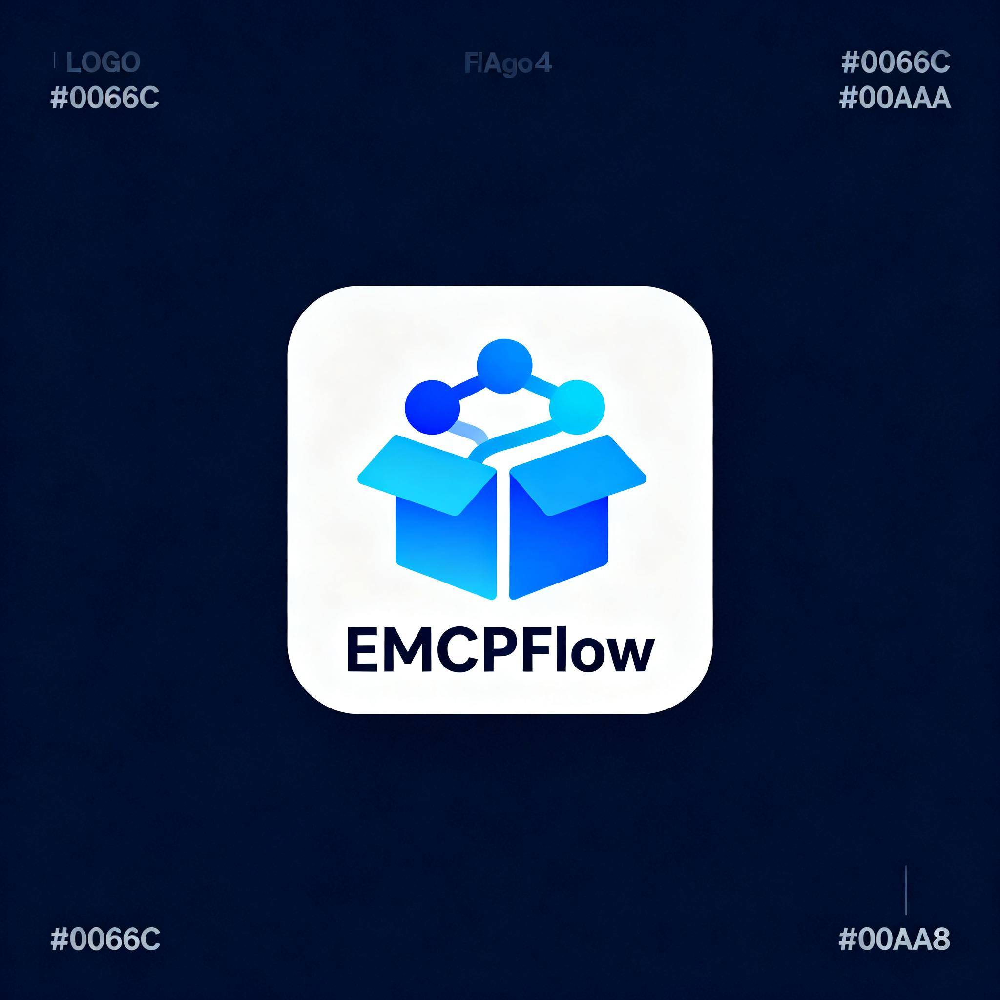
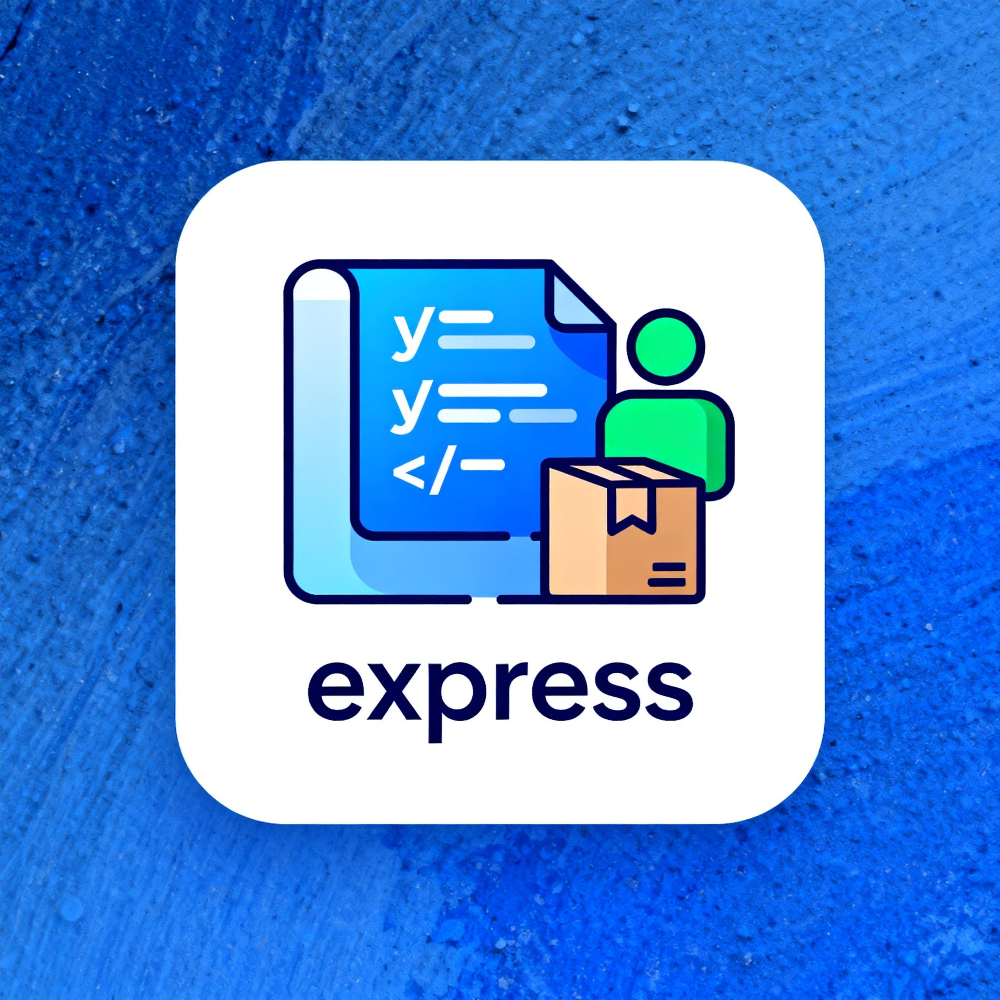

# 即梦 MCP Logo 生成器

## 快速开始 ⚡

### 一行命令生成 Logo

```bash
python jimeng_logo_generator.py <包地址>
```

### 示例

```bash
# PyPI 包
python jimeng_logo_generator.py requests

# NPM 包
python jimeng_logo_generator.py express

# Docker 镜像
python jimeng_logo_generator.py nginx/nginx
```

## 输出结果 📦

- ✅ **即梦 URL** - 立即可用 (24小时有效)
- ✅ **本地图片** - `logo_<包名>.png`
- ✅ **结果 JSON** - `logo_result_<包名>.json`
- ⚠️ **EMCP URL** - 如果上传成功

## 功能流程 🎯

```
包地址 → 获取包信息 → 生成提示词 → 即梦MCP生成 → 保存本地 → (尝试上传EMCP) → 完成!
```

## Python API 💻

```python
from jimeng_logo_generator import JimengLogoGenerator

jimeng_config = {
    "base_url": "http://mcptest013.sitmcp.kaleido.guru/sse",
    "headers": {
        "emcp-key": "YOUR_EMCP_KEY",
        "emcp-usercode": "VGSdDTgj"
    }
}

generator = JimengLogoGenerator(jimeng_config)

result = generator.generate_logo_from_package("requests")

if result['success']:
    print(f"Logo URL: {result['logo_url']}")
    print(f"本地文件: {result['local_file']}")
```

## 生成示例 🎨

### EMCPFlow Logo


**特点**: 蓝色渐变、包裹图标、连接节点、2048x2048

### Express Logo


**特点**: JavaScript 代码、用户图标、NPM 包管理风格

## 详细文档 📖

查看完整文档: [使用说明_即梦MCP_Logo生成器.md](使用说明_即梦MCP_Logo生成器.md)

## 技术栈 🛠️

- **即梦 MCP 4.0** - AI 图片生成
- **PackageFetcher** - 包信息获取 (PyPI/NPM/Docker)
- **SSE (Server-Sent Events)** - 实时通信
- **Python Requests** - HTTP 请求

## 主要特性 ✨

| 特性 | 说明 |
|------|------|
| 🎨 **AI 生成** | 即梦 4.0 高质量图片生成 |
| 📦 **自动识别** | 支持 PyPI/NPM/Docker |
| 🚀 **一键生成** | 输入包地址即可 |
| 💾 **自动保存** | 本地文件 + JSON 结果 |
| 🔄 **智能提示词** | 根据包信息自动生成 |
| 📊 **高分辨率** | 支持 4K (2048x2048) |

## 依赖安装 📦

```bash
pip install requests sseclient-py
```

## 常见问题 ❓

### Q: EMCP 上传失败怎么办？

A: 使用即梦 URL (临时) 或本地文件 (手动上传)

### Q: 即梦 URL 有效期多久？

A: 约 24 小时，建议立即下载保存

### Q: 支持哪些包平台？

A: PyPI、NPM、Docker Hub

### Q: 如何自定义提示词？

A: 修改 `_create_logo_prompt()` 方法

## 示例结果 📋

```json
{
  "success": true,
  "logo_url": "https://p9-aiop-sign.byteimg.com/...",
  "jimeng_url": "https://p9-aiop-sign.byteimg.com/...",
  "emcp_url": null,
  "local_file": "logo_express.png",
  "package_info": {
    "type": "npm",
    "package_name": "express"
  },
  "prompt": "express Logo 设计:..."
}
```

## 项目地址 🔗

- **项目**: EMCPFlow
- **开发**: 巴赫工作室 (BACH Studio)

---

**Made with ❤️ by 巴赫工作室**

